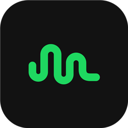
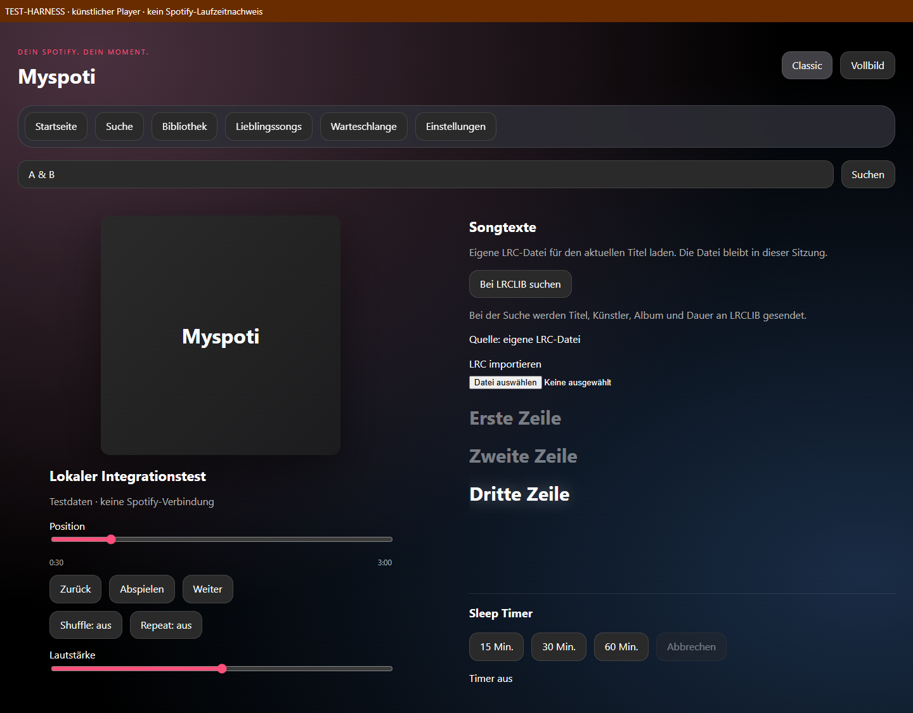

<h1 align="center">Myspoti für Windows</h1>

Deine Musik. Zwei Looks. Ein eigener Desktop-Einstieg.

<a href="https://github.com/weikiboy-tech/myspoti-desktop/releases/download/v0.1.0-preview.1/Myspoti-Setup.exe"><b>⬇ Windows-Installer herunterladen (.exe)</b></a> Vorschau · Windows x64 · Spotify 1.3.8.620

<a href="docs/INSTALL.md"><b>Installation</b></a> · <a href="docs/STATUS.md">Funktionen & Stand</a> · <a href="CONTRIBUTING.md">Mitentwickeln</a> · <a href="https://github.com/weikiboy-tech/myspoti-desktop/issues">Fehler melden</a>

> **Entwicklungsversion.** Myspoti läuft derzeit als eigene Oberfläche im Spotify-Desktop-Client. Es ist noch keine unabhängige Musik-App. Eine kleine Setup-EXE ist als experimentelle Vorschau verfügbar (Windows x64, Spotify 1.3.8.620).

*Vorschau aus dem Browser-Test mit künstlichem Player, ohne echtes Spotify-Konto. Kein Nachweis vollständiger Funktionsparität.*

### Was du schon bekommst

- **Classic & Immersive:** zwei Ansichten mit Akzentfarbe, AMOLED-Option und reduzierter Bewegung.
- **Player:** Titel, Cover und Wiedergabesteuerung über den installierten Spotify-Client.
- **Songtexte:** eigene LRC-Dateien oder manueller LRCLIB-Abruf, mit zeilenweiser Navigation.
- **Desktop-Einstieg:** Myspoti-Symbol auf dem Desktop und im Startmenü; Myspoti öffnet sich beim Clientstart.

Welche Funktionen im echten Client geprüft wurden und welche nur automatisiert: **[aktueller Stand](docs/STATUS.md)**.

### Installieren

**[Myspoti Setup herunterladen](https://github.com/weikiboy-tech/myspoti-desktop/releases/tag/v0.1.0-preview.1)** → EXE öffnen → Voraussetzungen prüfen → installieren. Spotify muss bereits installiert sein; Spicetify wird automatisch aus der offiziellen Quelle bezogen. [Anleitung und Grenzen](docs/INSTALL.md).

**Dein Konto bleibt deins:** Dieses Repository enthält keine Spotify-Anmeldedaten, Benutzerprofile oder Spotify-Binärdateien. Jeder Nutzer installiert Spotify selbst und nutzt sein eigenes Konto. Myspoti liefert keinen Premium-Zugang mit.

### Im Repository zurechtfinden

| Ordner | Inhalt |
|---|---|
| [`desktop/`](desktop/) | Aktive Windows-/Spicetify-Entwicklung, Build und Tests |
| [`docs/`](docs/README.md) | Installation, Status und technische Dokumentation |
| [`base/`](base/) | Erhaltene Android-Originalquellen als Portierungsgrundlage |
| [`tools/`](tools/) | Werkzeuge des Android-Upstreams |

Die Android-App ist separat in der **[Original-README](README.android.md)** dokumentiert. Ihre Features sind keine Zusage für Windows.

### Herkunft & Lizenz

Abgeleitet von **[Myspoti von kota-zo](https://github.com/kota-zo/myspoti)**. Das Immersive-Design hat seinen Ursprung in [BitChord](https://github.com/kushagrasinghx/BitChord). Originalquellen und Urheberhinweise bleiben erhalten. Nicht mit Spotify verbunden oder von Spotify unterstützt.

**[GPL-3.0](LICENSE)** · [Drittanbieterhinweise](THIRD_PARTY_NOTICES.md) · [Original-Credits](README.android.md#credits)
