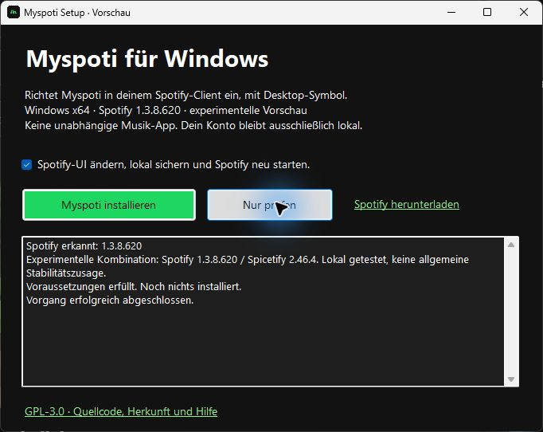

# Myspoti unter Windows installieren

## Einfacher Weg: Setup-Vorschau

1. [Myspoti-Setup.exe herunterladen](https://github.com/weikiboy-tech/myspoti-desktop/releases/tag/v0.2.0-preview.1).
2. EXE öffnen und **Nur prüfen** wählen.
3. Den Hinweis zu lokaler Sicherung, UI-Änderung und Spotify-Neustart bestätigen, dann **Myspoti installieren**.
4. Danach über das Myspoti-Symbol auf dem Desktop starten. Mit deinem eigenen Konto im offiziellen Spotify-Client anmelden.



Der Installer lädt Spicetify 2.46.4 von dessen offiziellem GitHub-Release und prüft eine fest hinterlegte SHA-256-Prüfsumme. Er sichert vorhandene Konfiguration und Myspoti-Dateien lokal, aktiviert die Oberfläche und legt die Verknüpfungen an. Node.js und PowerShell-Befehle sind dafür nicht nötig.

**Vorschau, nicht allgemein freigegeben:** Windows x64 und die lokal getestete Spotify-Version 1.3.8.620 sind erforderlich. Andere Versionen werden ohne Client-Änderung abgewiesen. Spotify muss selbst installiert und einmal gestartet worden sein; der Link im Setup führt zum offiziellen Download. Die Store-Version ist nicht unterstützt. Die EXE ist noch nicht digital signiert. Ein Test auf einem vollständig frischen PC steht aus. Es ist weiterhin keine unabhängige Musik-App.

Die folgenden Schritte sind die manuelle Alternative für Entwickler.

## Voraussetzungen

- Offizieller Spotify-Desktop-Client und dein eigenes Konto.
- [Spicetify](https://spicetify.app/docs/getting-started), eingerichtet für deine Spotify-Installation. Marketplace ist nicht erforderlich.
- Node.js ab Version 22 zum Bauen der Custom-App.

Lokal getestet: Spotify 1.3.8.620 / Spicetify 2.46.4. Diese Kombination liegt außerhalb der angegebenen Spicetify-Unterstützung bis Spotify 1.3.7. [Details](STATUS.md).

## Einrichten

1. Dieses Repository herunterladen oder klonen. PowerShell im Ordner `desktop` öffnen.
2. Custom-App bauen:

   ```powershell
   npm test
   npm run build
   ```

3. Den erzeugten Ordner `dist\myspoti-desktop` nach `%APPDATA%\spicetify\CustomApps\` kopieren. Einen vorhandenen gleichnamigen Ordner zuerst sichern.
4. Mit der installierten Spicetify-CLI aktivieren. Die Sicherung ist vor Änderungen erforderlich; `apply` kann Spotify neu starten und laufende Wiedergabe unterbrechen:

   ```powershell
   spicetify backup
   spicetify config custom_apps myspoti-desktop
   spicetify apply
   ```

5. Desktop- und Startmenü-Symbol erstellen:

   ```powershell
   .\tools\install-shortcut.ps1
   ```

Danach **Myspoti** über das neue Symbol öffnen. Die Anmeldung erfolgt ausschließlich im offiziellen Spotify-Client. Niemand erhält ein vorangemeldetes Konto.

## Entfernen

```powershell
spicetify config custom_apps myspoti-desktop-
spicetify apply
```

Anschließend die Myspoti-Verknüpfungen auf Desktop und im Startmenü entfernen. Andere Spicetify-Anpassungen bleiben aktiviert. `spicetify restore` würde sämtliche Spicetify-Anpassungen zurücksetzen.

## Probleme melden

[Issue öffnen](https://github.com/weikiboy-tech/myspoti-desktop/issues/new/choose) und Windows-, Spotify- und Spicetify-Version sowie die konkreten Schritte nennen. Keine Cookies, Tokens, Kontoexporte oder vollständigen Benutzerprofile hochladen.

Linux gesucht? [Zur Linux-Installation](INSTALL-LINUX.md).
